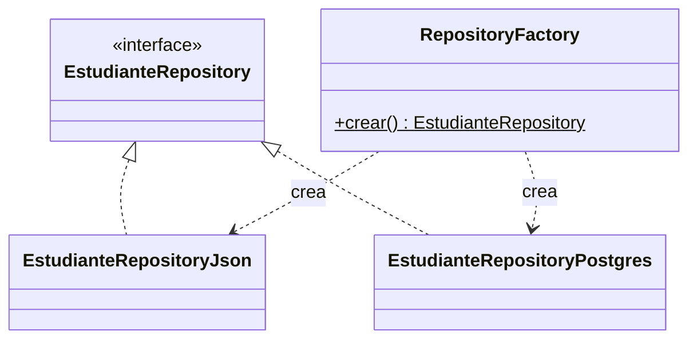
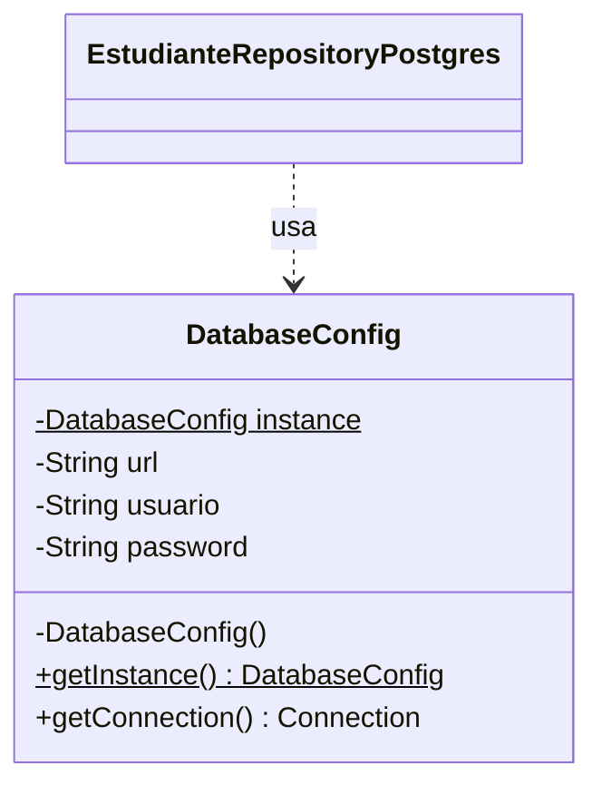
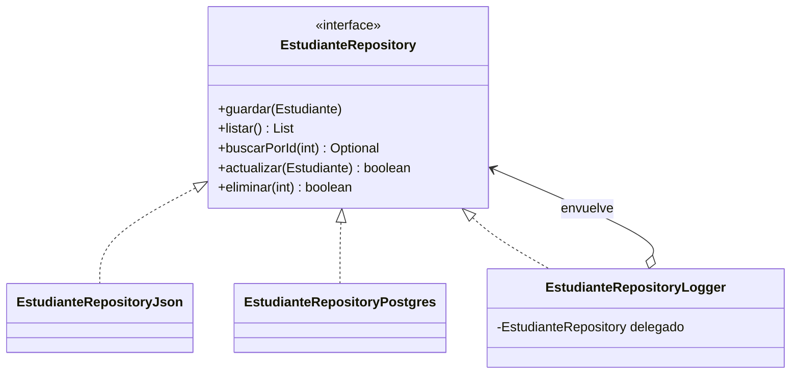
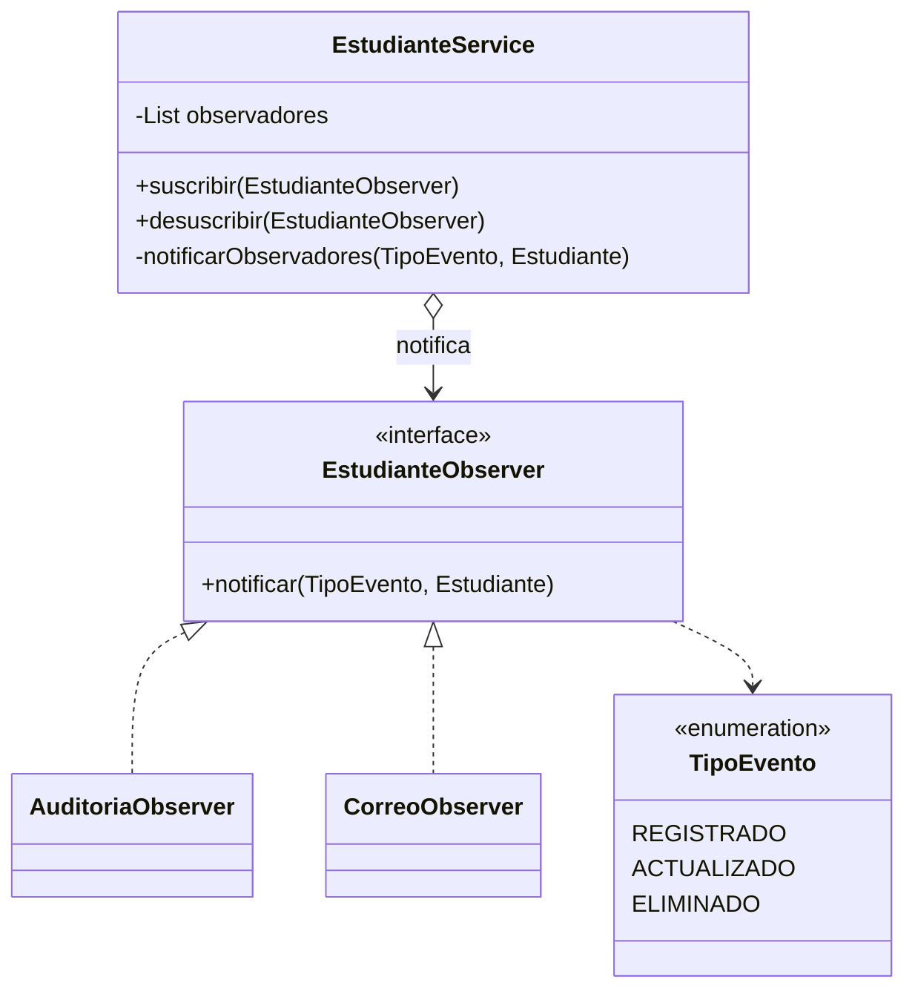
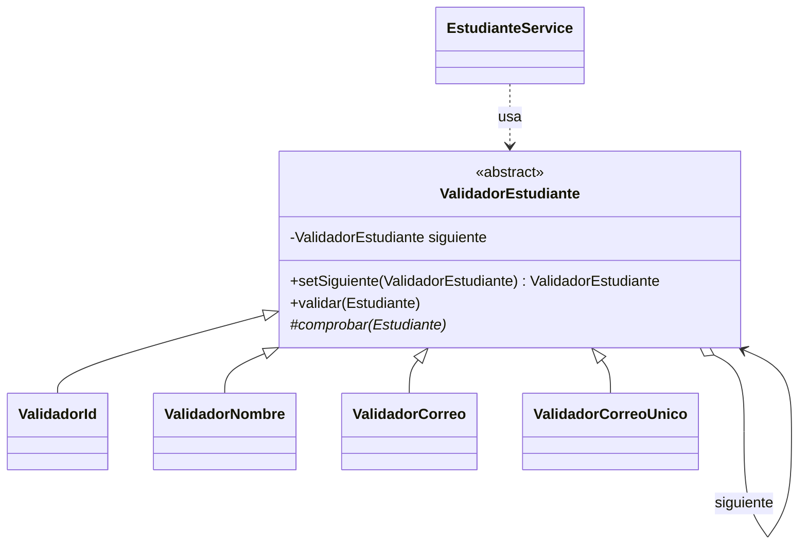
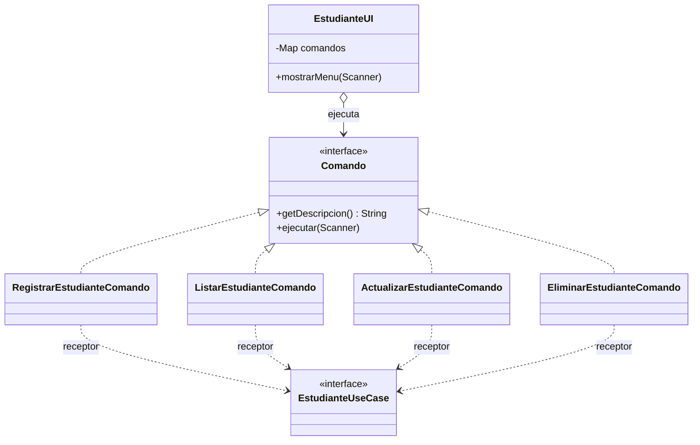

# Laboratorio 05: Implementación de Patrones de Diseño

**Asignatura:** IS488 – Arquitectura de Software | **Semestre:** 2026-II
**Estudiante:** Miriam Reyna Jaime Nuñez
**Sistema:** Gestión Académica (arquitectura hexagonal, Java + Maven)

## Cómo ejecutar

- Requiere el JDK indicado en `pom.xml` y Maven.
- Clase principal: `com.academico.Main`.
- Almacenamiento, según la variable de entorno `STORAGE_TYPE`:
    - `JSON` (por defecto): usa `data/estudiantes.json`.
    - `POSTGRES`: usa `DB_URL`, `DB_USER` y `DB_PASSWORD`.

## Patrones implementados

| Tipo | Patrón | Dónde está en el código |
|---|---|---|
| Creacional | Factory (visto en clase) | `infrastructure.adapter.in.RepositoryFactory` |
| Creacional | Singleton | `infrastructure.config.DatabaseConfig` |
| Estructural | Decorator | `infrastructure.adapter.out.decorator.EstudianteRepositoryLogger` |
| Comportamiento | Observer | `application.observer` e `infrastructure.adapter.out.observer` |
| Adicional | Chain of Responsibility | `application.validation` |
| Adicional | Command | `presentation.command` |


## 1. Factory

`RepositoryFactory.crear()` decide, según la variable `STORAGE_TYPE`, qué implementación de `EstudianteRepository` se crea (JSON o PostgreSQL). El resto del sistema solo conoce la interfaz y no depende de las clases concretas. Es la variante *Simple Factory* (método estático); además, el repositorio creado se entrega envuelto por el Decorator descrito más abajo.



## 2. Singleton

`DatabaseConfig` centraliza la configuración de acceso a PostgreSQL. Tiene constructor privado, una única instancia y un punto de acceso global, `getInstance()`, protegido con `volatile` y un bloque `synchronized` para que dos hilos no creen dos instancias. La configuración se carga una sola vez y `EstudianteRepositoryPostgres` la reutiliza.



Salida de la demostración en `Main`:

```
[DatabaseConfig] Configuración cargada (una sola vez).
¿Misma instancia? true
```


## 3. Decorator

`EstudianteRepositoryLogger` implementa la misma interfaz que el repositorio que envuelve (`EstudianteRepository`) y registra cada operación antes y después de delegarla. Así se añade una funcionalidad nueva sin modificar `EstudianteRepositoryJson`, `EstudianteRepositoryPostgres` ni `EstudianteService`. `RepositoryFactory` entrega el repositorio ya decorado.



Salida al listar estudiantes:

```
[LOG] listar
[LOG] listar: 3 registro(s)
```

## 4. Observer

`EstudianteService` actúa como publicador: cuando se registra, actualiza o elimina un estudiante, notifica a todos sus suscriptores. Los observadores concretos son `AuditoriaObserver` (deja constancia con fecha y hora) y `CorreoObserver` (simula el envío de un correo). Se suscriben desde `Main`, y el servicio no conoce sus clases concretas, solo la interfaz `EstudianteObserver`.



Salida al eliminar un estudiante (se ven juntos el Decorator y el Observer):

```
[LOG] buscarPorId -> 3
[LOG] buscarPorId: encontrado
[LOG] eliminar -> 3
[LOG] eliminar: éxito
[AUDITORÍA] 27/10/2026 10:22:34 - ELIMINADO - id=3, nombre=Miriam
[CORREO] Para: miriam@unsch.com | Tu registro fue eliminado del sistema.
Estudiante eliminado.
```


## 5. Chain of Responsibility (patrón adicional)

Antes de registrar o actualizar, el estudiante pasa por una cadena de validadores. Cada eslabón comprueba una sola regla: si se cumple, pasa la solicitud al siguiente; si no, la cadena se corta con un mensaje claro. La cadena se arma en `Main` y `EstudianteService` solo conoce el primer eslabón, así que se pueden agregar o quitar reglas sin tocar el servicio. Además evita que un ID repetido cierre el programa, porque la interfaz captura el error y lo muestra.

`ValidadorId` → `ValidadorNombre` → `ValidadorCorreo` → `ValidadorCorreoUnico`



Casos de prueba, uno por eslabón:

| ID | Nombre | Correo | Resultado |
|---|---|---|---|
| -1 | Ana | ana@unsch.edu.pe | El ID no puede ser negativo. |
| 10 | (vacío) | ana@unsch.edu.pe | El nombre no puede estar vacío. |
| 10 | Ana | ana-sin-arroba | El correo no tiene un formato válido. |
| 10 | Ana | alberto@unsch.edu.pe | Ya existe un estudiante con ese correo. |
| 10 | Ana | ana@unsch.edu.pe | Registro exitoso |

## 6. Command (patrón adicional)

Cada opción del menú de estudiantes es un objeto que implementa `Comando`. `EstudianteUI` es el invocador: guarda los comandos en un mapa y ejecuta el que elige el usuario, sin un `switch` fijo. `EstudianteUseCase` es el receptor, que hace el trabajo real. Para agregar una opción al menú basta crear una clase nueva y registrarla en el mapa.



## Historial de trabajo

Cada patrón se desarrolló en su propia rama (`feature/singleton`, `feature/decorator`, `feature/observer`, `feature/chain-validacion`, `feature/command`) y se integró a `master` con un commit de merge.