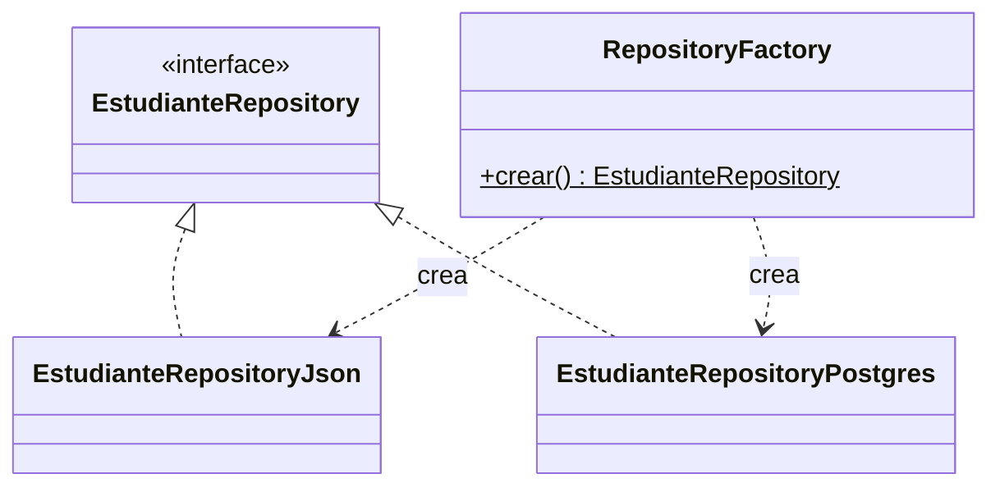
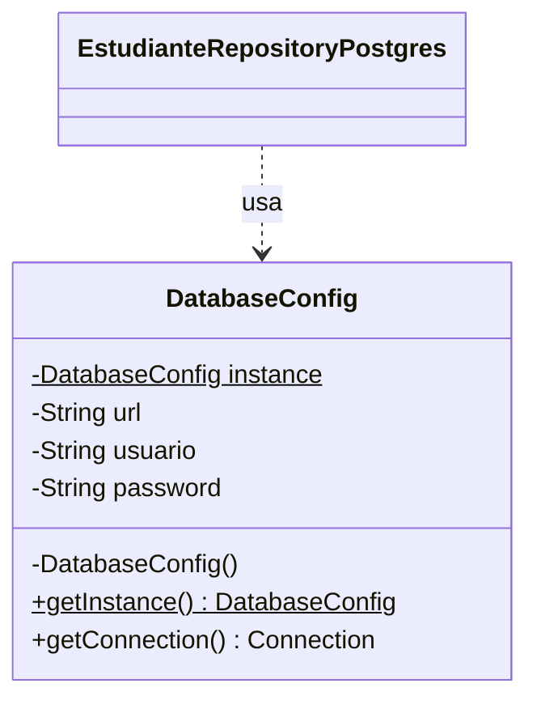

# Laboratorio 05: Implementación de Patrones de Diseño

**Asignatura:** IS488 – Arquitectura de Software | **Semestre:** 2026-II
**Estudiante:** Miriam Reyna Jaime Nuñez
**Sistema:** Gestión Académica (arquitectura hexagonal, Java + Maven)

## Cómo ejecutar

- Requiere el JDK indicado en `pom.xml` y Maven.
- Clase principal: `com.academico.Main`.
- Almacenamiento, según la variable de entorno `STORAGE_TYPE`:
    - `JSON` (por defecto): usa `data/estudiantes.json`.
    - `POSTGRES`: usa `DB_URL`, `DB_USER` y `DB_PASSWORD`.

## Patrones implementados

| Tipo | Patrón | Dónde está en el código |
|---|---|---|
| Creacional | Factory (visto en clase) | `infrastructure.adapter.in.RepositoryFactory` |
| Creacional | Singleton | `infrastructure.config.DatabaseConfig` |
| Estructural | Decorator | `infrastructure.adapter.out.decorator.EstudianteRepositoryLogger` |
| Comportamiento | Observer | `application.observer` e `infrastructure.adapter.out.observer` |
| Adicional | Chain of Responsibility | `application.validation` |
| Adicional | Command | `presentation.command` |


## 1. Factory

`RepositoryFactory.crear()` decide, según la variable `STORAGE_TYPE`, qué implementación de `EstudianteRepository` se crea (JSON o PostgreSQL). El resto del sistema solo conoce la interfaz y no depende de las clases concretas. Es la variante *Simple Factory* (método estático); además, el repositorio creado se entrega envuelto por el Decorator descrito más abajo.



## 2. Singleton

`DatabaseConfig` centraliza la configuración de acceso a PostgreSQL. Tiene constructor privado, una única instancia y un punto de acceso global, `getInstance()`, protegido con `volatile` y un bloque `synchronized` para que dos hilos no creen dos instancias. La configuración se carga una sola vez y `EstudianteRepositoryPostgres` la reutiliza.



Salida de la demostración en `Main`:

```
[DatabaseConfig] Configuración cargada (una sola vez).
¿Misma instancia? true
```